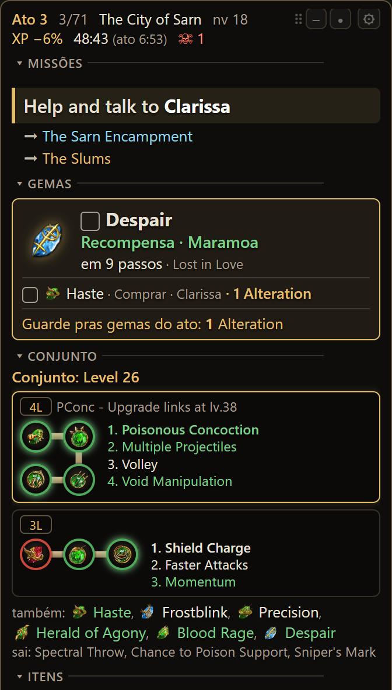
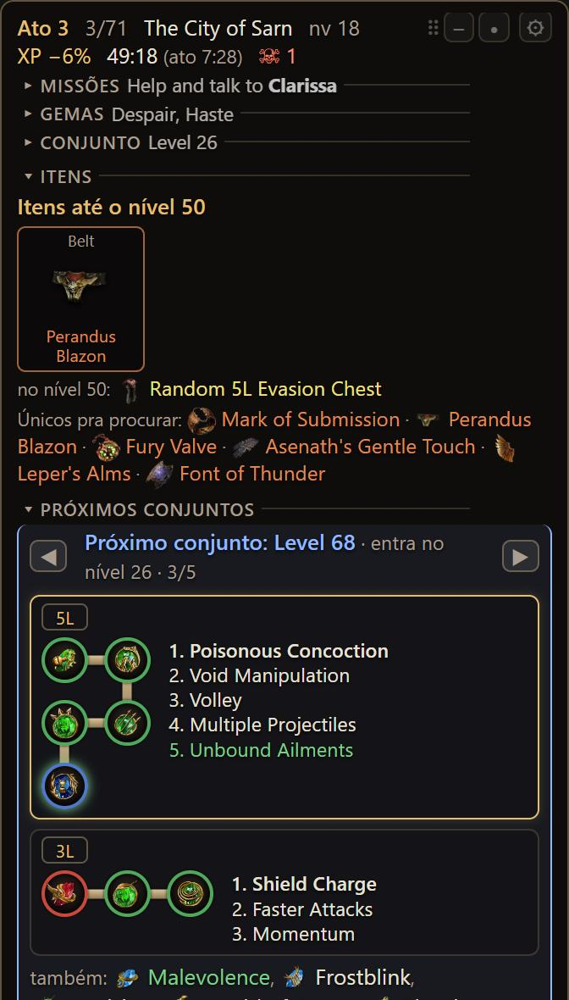
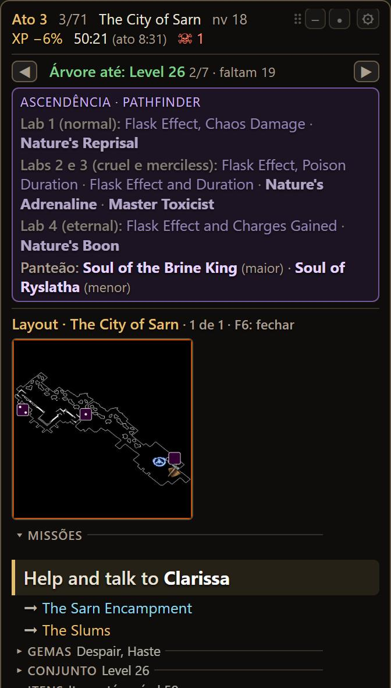
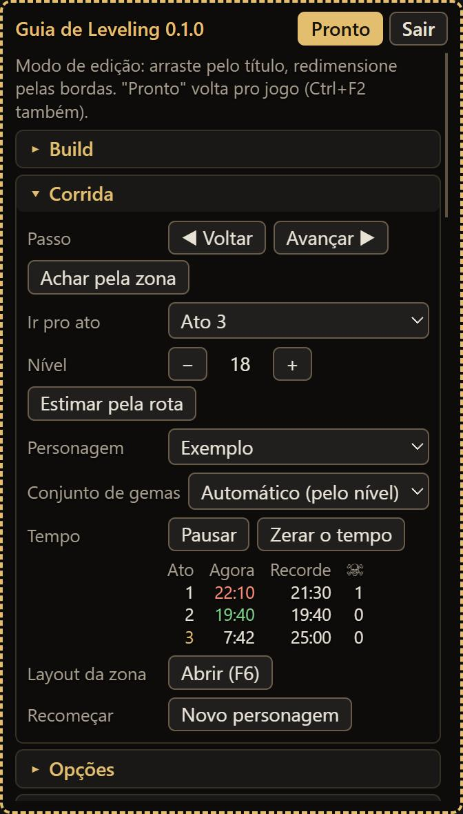
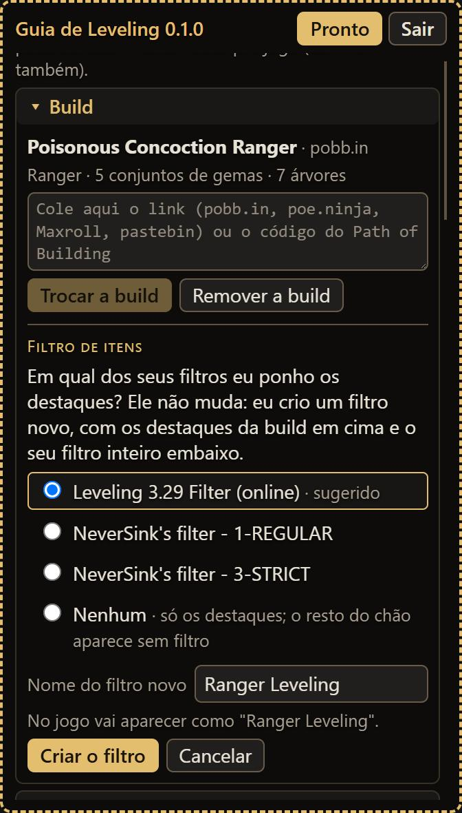

# Guia de Leveling (Path of Exile 1)

Overlay pra campanha do Path of Exile 1, atos 1 a 10. Você cola o link da build e o guia mostra, por cima do jogo, o próximo passo da rota, as gemas pra pegar ou comprar, os links de cada conjunto, os itens, o layout da zona e os próximos pontos da árvore de passivas. Ele avança sozinho lendo o `Client.txt` do jogo.

Programa pra Windows, em português. Feito com [Tauri 2](https://tauri.app) (Rust e React).

## Como ele é

<table>
<tr>
<td width="33%"></td>
<td width="33%"></td>
<td width="33%"></td>
</tr>
<tr>
<td valign="top"><b>Rota e gemas.</b> O passo da rota, a gema que a missão dá, a que precisa comprar (de quem e por quanto) e os links do conjunto atual, com as gemas que você já tem marcadas.</td>
<td valign="top"><b>Itens e próximos conjuntos.</b> Os itens da build com foto, os únicos pra procurar e o próximo conjunto de gemas, com o nível em que ele entra.</td>
<td valign="top"><b>Árvore, ascendência e layout.</b> A etapa da árvore de passivas, o que pegar em cada lab, o panteão e o mapa da zona (<code>F6</code>).</td>
</tr>
<tr>
<td width="33%"></td>
<td width="33%"></td>
<td width="33%" valign="top" rowspan="2">
<b>E também:</b>
<ul>
<li>pisca uma moldura na gema certa na loja do vendedor;</li>
<li>marca os próximos pontos por cima da árvore de passivas do jogo;</li>
<li>botões de busca da loja: <code>Alt</code>+clique e a busca vai pro jogo;</li>
<li>aviso de XP perdida pela diferença entre o seu nível e o da zona;</li>
<li>vira uma bolinha quando o Mundo, o Baú ou o vendedor está aberto.</li>
</ul>
</td>
</tr>
<tr>
<td valign="top"><b>Tempos por ato.</b> O relógio da corrida, o recorde de cada ato e as mortes. Verde dentro do recorde, vermelho acima.</td>
<td valign="top"><b>Build e filtro.</b> Importa de pobb.in, poe.ninja, Maxroll, pastebin ou do código do Path of Building. Cria um filtro de itens que destaca o que a build usa, por cima do seu filtro.</td>
</tr>
</table>

Os dados das prints são de exemplo.

## O que ele faz com o jogo

Foi feito dentro das regras da GGG pra programas de terceiros, como os outros overlays conhecidos:

- É uma janela separada por cima do jogo. Não lê a memória do jogo, não injeta nada no processo dele e não mexe na rede dele.
- Lê o `Client.txt` (só leitura) pra saber a zona, o nível e as mortes.
- Tira fotos da tela, só com o jogo na frente, pra reconhecer a árvore de passivas, o ícone das gemas na loja e os painéis abertos. As fotos ficam só na memória do guia. Cada leitura tem a sua opção pra desligar.
- Não manda tecla nem clique pro jogo, com uma exceção: quando você segura `Alt` e clica num botão de busca da loja, ele manda `Ctrl+F`, `Ctrl+V` e `Enter` uma vez, igual o Awakened PoE Trade.
- Cada tecla do guia faz uma ação só, no próprio guia.

## Baixar e instalar

1. Baixe o `.zip` da [última versão](https://github.com/irandsj/guia-de-leveling-poe/releases/latest) e extraia.
2. Abra `Instalar Guia de Leveling.exe`. Ele instala só pro seu usuário, sem pedir administrador.
3. O instalador não tem assinatura digital, então o Windows pode mostrar "O Windows protegeu o computador". Clique em **Mais informações** e depois em **Executar assim mesmo**.
4. No jogo, escolha "Windowed Fullscreen" nas opções de vídeo.
5. Abra o guia e aperte `Ctrl+F2`. Cole o link da build, clique em **Importar** e depois em **Pronto**.

O `LEIA-ME.txt` do zip tem o passo a passo inteiro. O guia precisa do WebView2, que já vem no Windows 11 e no Windows 10 atualizado. Funciona melhor com o jogo em inglês.

## Manual

As teclas, as opções, onde ficam os dados e as limitações estão em [`app/README.md`](app/README.md).

## Compilar

Precisa de Node 22 e Rust. Na pasta `app`:

```
npm install
npm run tauri dev
npm test
npm run tauri build
```

`npm run dev` abre só a interface no navegador, em `http://localhost:1420`. Lá, o `window.simular` do console faz de conta que o jogo mandou uma zona, um nível, uma morte ou uma tecla.

## Créditos e licença

O código deste projeto é MIT ([LICENSE](LICENSE)). O que veio de terceiros segue a licença de cada um, listada em [`terceiros/LEIA-ME.md`](terceiros/LEIA-ME.md):

- rota e dados de gemas: [exile-leveling](https://github.com/HeartofPhos/exile-leveling), de HeartofPhos (MIT);
- imagens de layout das zonas: [Exile-UI](https://github.com/Lailloken/Exile-UI), de Lailloken (MIT);
- dados da árvore de passivas: [skilltree-export](https://github.com/grindinggear/skilltree-export), da Grinding Gear Games;
- ícones das gemas e fotos dos itens: arte da Grinding Gear Games, via [poedb](https://poedb.tw).

Path of Exile e a arte do jogo são da Grinding Gear Games. Este projeto não é ligado à GGG nem aprovado por ela.
